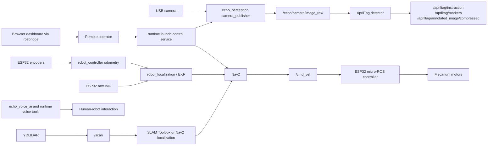
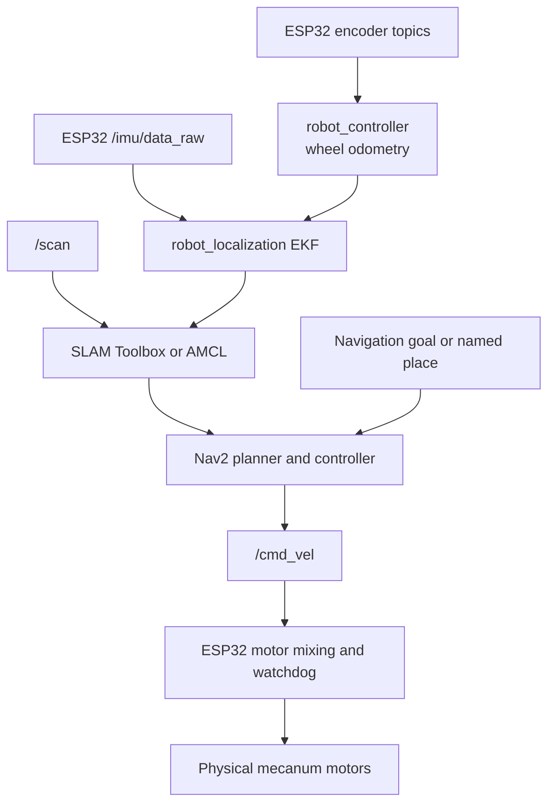

# Echo: an embodied-AI mobile robot

Echo is a physical indoor mobile-robot project built around a Raspberry Pi 5,
an ESP32 low-level controller, and ROS 2 Jazzy. The repository brings together
embedded motor control, wheel odometry, inertial sensing, LiDAR-based
localization, camera perception, navigation, voice interaction, and a browser
dashboard.

The project is presented as an academic portfolio rather than a production
release. The source documents a substantial robotics system, but ROS 2 builds,
full launch validation, and physical-robot tests have not been completed in the
current development environment.

## Status at a glance

| Area | Status |
| --- | --- |
| ROS 2 packages, robot description, launch files, and configuration | Implemented source |
| ESP32 micro-ROS motor, encoder, and IMU firmware | Implemented source |
| Wheel odometry and localization configuration | Implemented source; hardware behavior unverified here |
| LiDAR, SLAM Toolbox, and Nav2 integration | Implemented configuration and launch surfaces |
| Camera and AprilTag perception | Implemented ROS 2 pipeline |
| Voice wake-word, speech, and text-to-speech tools | Experimental integrations requiring local dependencies and credentials |
| Browser dashboard and launch-control service | Implemented source and static assets |
| End-to-end ROS 2 build and physical validation | Not completed in this environment |

## Why Echo is an embodied-AI project

Echo is not only a language interface or a collection of simulations. Its
software is designed to connect perception and decision-making to a physical
platform:

- A camera and LiDAR observe the robot's environment.
- Wheel encoders and an IMU provide motion-related measurements.
- ROS 2 nodes transform sensor data into odometry, localization, perception
  outputs, and navigation inputs.
- Nav2 produces velocity commands that cross the ROS 2/micro-ROS boundary.
- The ESP32 applies those commands to physical motors and reports encoder and
  IMU data back to the Raspberry Pi.
- Voice and visual interfaces provide human-facing ways to observe or interact
  with the system.

This physical loop introduces constraints that do not appear in a purely
software agent: sensor noise, timing, calibration, serial communication,
limited compute, actuator behavior, wheel slip, and safety watchdogs. Echo
contains the components needed to study that loop, while its integration and
hardware behavior remain explicitly unverified in the current environment.

## Project visuals

The repository includes the animated face assets used by the display
application. The face is a visual interaction surface, not a perception model.

| Idle | Listening | Thinking | Speaking |
| --- | --- | --- | --- |
|  |  |  |  |

Useful future additions would be photographs of the assembled robot, its sensor
layout, the electronics, and the dashboard running against a live robot. Those
images are not currently stored in the repository.

## Hardware

The following hardware is represented in the source or project documentation:

| Component | Role in Echo | Evidence and status |
| --- | --- | --- |
| Raspberry Pi 5 | Runs Ubuntu/ROS 2 nodes, launch surfaces, navigation, perception, and operator tools | Project platform documented; not tested in this Windows environment |
| ESP32 | Runs the low-level micro-ROS controller | `firmware/esp32/echo_low_level_controller/` publishes encoders and raw IMU data and subscribes to `/cmd_vel` |
| Four-wheel mecanum chassis | Provides holonomic motion | Represented in the robot description and ESP32 motor mixing |
| Wheel motors and encoders | Actuation and wheel-motion measurement | GPIO assignments and encoder topics are defined in the firmware |
| IMU | Publishes raw acceleration and angular velocity | Firmware reads an I2C IMU at address `0x68`; the exact physical module is not independently verified here |
| YDLIDAR | Supplies 2D range data for mapping and navigation | `ydlidar_ros2_driver` and `/scan` configuration are present |
| USB camera | Publishes raw and JPEG-compressed camera frames | `echo_perception` uses OpenCV and publishes `/echo/camera/image_raw` and `/echo/camera/image/compressed` |
| Display | Shows animated Echo face states | `runtime/app/echo_face.py` loads the tracked face assets |

GPS support was not found in the active ROS 2 packages, firmware, or launch
surfaces inspected for this README. It should therefore be treated as
unimplemented or outside the current system, rather than as an installed
sensor.

## Software architecture

The canonical ROS 2 source tree is `src/`. The project is organized as one
workspace-style package tree rather than multiple competing workspaces.



### Package roles

| Package | Responsibility |
| --- | --- |
| `echo_bringup` | System launch files and operator startup scripts |
| `echo_description` | URDF/Xacro robot, drivetrain, sensor, and visualization descriptions |
| `echo_hardware` | Hardware-related ROS 2 install surface |
| `echo_navigation` | Navigation maps and navigation-related resources |
| `echo_perception` | Camera publishing, AprilTag detection, annotated images, and WebRTC support |
| `echo_teleop` | Teleoperation nodes and joystick-related support |
| `echo_voice_ai` | Wake-word and voice/display helper scripts |
| `robot_controller` | Motor, encoder, IMU, wheel-odometry, and EKF launch/configuration support |
| `micro_ros_agent` | Vendored micro-ROS agent package |
| `ydlidar_ros2_driver` | Vendored YDLIDAR ROS 2 driver |
| `rosboard` | Optional ROSboard visualization package retained because startup scripts reference it |

The package tree contains both Echo-developed code and vendored or upstream
components. Package-level manifests and upstream documentation identify their
individual dependencies and licenses.

## Perception

### Camera and AprilTags

`src/echo_perception/scripts/camera_publisher.py` opens an OpenCV camera and
publishes:

- `/echo/camera/image_raw` as a ROS `Image`;
- `/echo/camera/image/compressed` as a JPEG `CompressedImage`.

`src/echo_perception/scripts/apriltag_detector.py` uses the
`pupil_apriltags.Detector` with the `tag36h11` family. For detected tags it:

- publishes a JSON instruction on `/apriltag/instruction`;
- publishes annotated JPEG frames on `/apriltag/annotated_image/compressed`;
- publishes approximate visualization markers on `/apriltag/markers`;
- maps selected tag IDs to actions such as stop, pause, resume, and goal
  instructions.

The detector estimates an approximate camera-frame point from tag size and
pixel dimensions. This is useful for visualization and experimentation, but it
is not a demonstrated metric localization system. The implementation uses
approximate camera intrinsics and does not by itself prove reliable autonomous
behavior.

The repository does not contain evidence of a trained object detector, lane
detector, or stop-sign model. The verified camera perception pipeline is the
OpenCV camera publisher, AprilTag detector, annotated-image output, and WebRTC
bridge.

### LiDAR

The YDLIDAR driver provides `/scan` data to the mapping and navigation launch
surfaces. LiDAR data is configured for obstacle and localization workflows,
but no performance benchmark or physical scan validation is claimed here.

## Localization, navigation, and control

The repository contains launch and configuration surfaces for:

- wheel odometry from encoder topics;
- an EKF using `robot_localization`;
- SLAM Toolbox mapping;
- saved-map localization with AMCL;
- Nav2 planning and costmaps;
- named-place navigation tools;
- RViz and robot-description visualization.

The control path is intended to follow this sequence:



The ESP32 firmware applies mecanum wheel mixing, maintains a command timeout,
publishes four encoder topics (`/encoders/FL`, `/encoders/FR`, `/encoders/RL`,
and `/encoders/RR`), and publishes `/imu/data_raw`. The
`esp32_encoder_odometry` node consumes those encoder topics and publishes
`/wheel_odom`.

These are implemented source paths and configuration surfaces, not a claim that
the complete navigation loop has been demonstrated. Wheel signs, frame
transforms, calibration, serial transport, LiDAR configuration, and Nav2
behavior require validation on the physical platform.

## BMO face and human-robot interaction

The display application in `runtime/app/echo_face.py` loads expression frames
from the directory selected by `ECHO_FACE_ROOT`; the repository's tracked
expressions are under `assets/bmo_faces/`. It supports the states:

`idle`, `listening`, `capturing`, `thinking`, `speaking`, `error`, and `warmup`.

The face gives the robot a visible interaction state and makes voice-system
feedback legible to a person nearby. It does not infer emotion and should not be
presented as an autonomous social-intelligence system.

## Voice AI

The voice components are split between the ROS package
`src/echo_voice_ai/` and the optional runtime tools under `runtime/app/`.
The source includes:

- Picovoice Porcupine wake-word detection;
- PvRecorder audio capture;
- Google Speech Recognition calls through `speech_recognition`;
- ElevenLabs text-to-speech requests;
- optional OpenClaw command/agent integration;
- optional Telegram notification integration;
- local playback through `ffplay`.

These integrations require external software, network access, and local
environment variables. Credentials are not stored in the repository. See
[docs/SECURITY.md](docs/SECURITY.md) and
[`runtime/voice/.env.example`](runtime/voice/.env.example).

The voice system is experimental from the perspective of this portfolio:
individual scripts are present, but no end-to-end voice-to-motion validation is
claimed. In particular, a voice response or OpenClaw request should not be
interpreted as proof that a safe navigation command reached the motors.

## Dashboard and monitoring

The browser dashboard is stored under `runtime/dashboard/`. It uses ROSLIB to
connect to a ROS bridge and provides operator-facing pages for connection,
telemetry, camera/video views, and selected controls. The repository also
contains:

- `runtime/launch_server/launch_server.py`, a small HTTP service that launches
  allow-listed commands and records their output;
- `runtime/systemd/`, service templates for robot-host deployment;
- a WebRTC camera bridge in `src/echo_perception/scripts/webrtc_server.py`;
- optional ROSboard and Foxglove launch surfaces.

The dashboard is therefore a browser client over ROS/web services, not a
standalone simulation or a replacement for ROS 2. Its live behavior depends on
the robot host, ROS bridge, camera pipeline, and local service configuration.

## Repository structure

```text
Echo/
├── README.md
├── .gitignore
├── docs/
│   ├── ARCHITECTURE.md
│   ├── DEVELOPMENT.md
│   ├── SECURITY.md
│   └── TOOLS.md
├── src/
│   ├── echo_bringup/
│   ├── echo_description/
│   ├── echo_hardware/
│   ├── echo_navigation/
│   ├── echo_perception/
│   ├── echo_teleop/
│   ├── echo_voice_ai/
│   ├── micro_ros_agent/
│   ├── robot_controller/
│   ├── rosboard/
│   └── ydlidar_ros2_driver/
├── firmware/
│   ├── esp32/
│   └── esp32_micro_ros_imu.ino
├── runtime/
│   ├── app/
│   ├── dashboard/
│   ├── launch_server/
│   ├── maps/
│   ├── openclaw_chat/
│   ├── places/
│   ├── systemd/
│   ├── tools/
│   └── voice/
└── assets/
    └── bmo_faces/
```

Generated workspaces, logs, caches, local credentials, and deployment-specific
overrides are intentionally not part of this public-facing layout.

## Environment and dependencies

The intended robot environment is Ubuntu 24.04 with ROS 2 Jazzy,
`colcon`, and `rosdep`. The ROS packages additionally reference Nav2, SLAM
Toolbox, `robot_localization`, `tf2`, RViz2, micro-ROS, and the YDLIDAR
dependencies. Optional Python tools use packages including OpenCV,
`pupil_apriltags`, `aiohttp`, `aiortc`, `av`, Picovoice libraries,
`SpeechRecognition`, and `requests`.

Keep credentials and machine-specific values outside Git. Use the environment
template in `runtime/voice/.env.example` as a starting point for local
configuration; do not copy real values into tracked files.

## Setup and launch surfaces

The following commands reflect the repository's intended ROS 2 workspace layout.
They have not been executed in the current Windows environment.

```bash
source /opt/ros/jazzy/setup.bash
rosdep install --from-paths src --ignore-src -r -y
colcon build --symlink-install
source install/setup.bash
```

Useful launch surfaces include:

```bash
ros2 launch echo_bringup robot_description_launch.py
ros2 launch echo_bringup mapping_launch.py
ros2 launch echo_bringup autonomous_navigation_launch.py
ros2 launch echo_bringup dashboard_launch.py
ros2 launch ydlidar_ros2_driver ydlidar_launch.py
ros2 run robot_controller encoder_odometry
ros2 run robot_controller esp32_encoder_odometry
```

The runtime dashboard and launch server are separate operator-facing layers.
Their service templates and environment bootstrap are under `runtime/`; service
installation should be performed only on the robot host and reviewed against
the local deployment paths.

## Hardware configuration boundary

The firmware defines the ESP32 GPIO assignments, encoder interrupts, I2C IMU
connection, serial micro-ROS transport, motor watchdog timeout, and encoder/IMU
publish rates. Those values are hardware-specific and should be changed only
with corresponding electrical and physical validation.

The ROS configuration also contains camera, LiDAR, frame, map, and navigation
parameters. Approximate camera intrinsics and robot-frame values are explicitly
marked in source where applicable. They should be calibrated and tested before
using the system for autonomous operation.

## Known limitations and future work

- ROS 2 Jazzy package builds and launch tests have not been run in the current
  environment.
- Physical motor, encoder, IMU, LiDAR, camera, and navigation tests have not
  been run as part of this repository organization.
- The AprilTag depth and camera-frame marker estimate uses approximate
  calibration values.
- The relationship between all optional operator surfaces, ROSboard, Foxglove,
  and the dashboard still requires deployment-level integration testing.
- Voice, cloud speech, ElevenLabs, OpenClaw, and Telegram integrations depend on
  external services and credentials.
- GPS support is not part of the verified active pipeline.
- Firmware variants and hardware calibration require a deliberate device-level
  validation process before deployment.

Potential future work includes calibrated camera geometry, reproducible
hardware-in-the-loop tests, safer action arbitration, navigation-state
debouncing for AprilTag actions, and a documented deployment procedure for the
Raspberry Pi and ESP32.

## Focused documentation

- [Architecture](docs/ARCHITECTURE.md)
- [Development and validation](docs/DEVELOPMENT.md)
- [Security and credential handling](docs/SECURITY.md)
- [Tools and operator notes](docs/TOOLS.md)

## Acknowledgements

Echo includes or depends on open-source projects and ecosystems including ROS 2,
Nav2, SLAM Toolbox, `robot_localization`, micro-ROS, YDLIDAR's ROS 2 driver,
ROSboard, OpenCV, `pupil_apriltags`, aiohttp, aiortc, and the Python packages
used by the optional voice integrations. Refer to the package directories and
upstream license files for the applicable notices.
